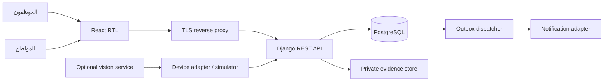

# المعمارية
Modular Monolith: تطبيق Django واحد، واجهة React مستقلة في البناء ومتحدة الأصل عند النشر.
المجالات: Identity/Tenancy، Registry، Enforcement، Evidence، Appeals، Finance، Audit/Outbox.
كل كتابة تمر بخدمة domain داخل transaction؛ كل query مقيد بالجهة، والمواطن مقيد بملكيته المتحققة إداريًا. لا بحث عام باللوحة.

الأحداث الخارجية ملاحظات تحتاج مراجعة بشرية؛ لا إصدار آلي لغرامة من نتيجة رؤية.
الحالة المالية ليست قيمة يعدلها العميل؛ تعتمد على دفتر الدفع ومبلغ snapshot وقت الإنشاء.
قفل صف المخالفة يمنع تعارض الاعتماد والدفع والاعتراض؛ version يرفض واجهات قديمة.
الجهة تملك رأس سلسلة التدقيق وتُقفل قبل الإضافة. DBA قادر على تغيير البيانات؛ يلزم anchor خارجي وWORM قبل اعتماد قانوني.

