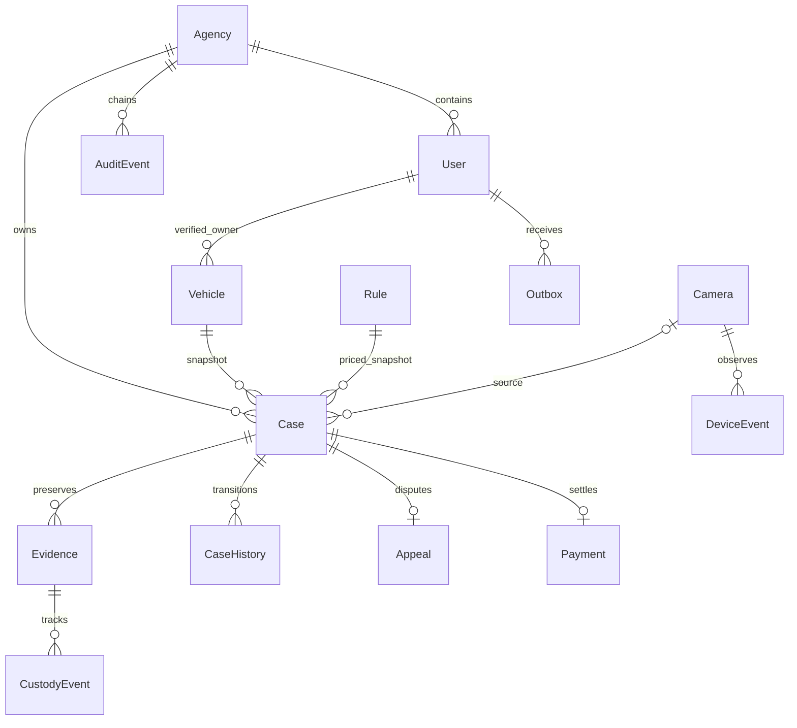

# تصميم البيانات والهجرة
UUID ثابت للجهات والكيانات؛ المستخدم له معرف داخلي ولا يستعمل لتخمين ملكية سجل.
كل كيان تشغيلي يحمل agency، وكل مفتاح خارجي يتحقق في serializer من الجهة.
الأموال Decimal(12,2) مع عملة منفصلة؛ لا جمع عابر للعملات. هذا الإصدار يدعم عملات ذات منزلتين فقط؛ العملات ذات ثلاث منازل تحتاج قرارًا وترحيلًا قبل الاستخدام.

- PROTECT على الروابط القانونية؛ لا DELETE API. PostgreSQL trigger يرفض تعديل/حذف AuditEvent/CaseHistory/Payment/Evidence/CustodyEvent.
- قفل Case قبل انتقال/اعتراض/تحصيل؛ قفل Agency عند إلحاق التدقيق؛ version يمنع تعديل من واجهة قديمة.
- UNIQUE للجهة+مرجع المصدر، الجهة+مرجع الدفع/idempotency، جهة+رمز قاعدة/كاميرا، جهة+دولة+منطقة+لوحة.
- CHECK للمبالغ الموجبة. فهرس جهة/حالة/تاريخ وجهة/مالك/تاريخ. صفحة 20 وحد أقصى100.
- حفظ snapshots للمالك/اللوحة/عنوان القاعدة/الغرامة/العملة/مدة الاعتراض. لا نغيّر قضية بتغيير سعر قاعدة.
- سلسلة SHA256 قابلة للتحقق؛ ليست منعًا لمسؤول قاعدة البيانات. يلزم anchor خارجي وWORM ومنع صلاحيات DDL لحساب التطبيق.

## هجرة النظام القديم
صدّر JSON بخصائص users/vehicles/cameras/violations من قاعدة قراءة فقط، باستخدام مخطط legacy/database/schema.sql. لا تُرسل SQL dump لتنفيذه.
حوّل التوقيت بoffset المصدر الصحيح، حدد العملة من الجهة، واحتفظ بنسخة مشفرة من المصدر.
`python manage.py import_legacy export.json --actor ADMIN --currency XXX` يجري dry-run ويرجع كل المعاملة.
بعد مراجعة counts والعلاقات: أعد الأمر مع `--apply`. UUIDv5 يحفظ mapping ثابتًا، hash ملف يمنع إعادة الاستيراد.
المستخدمون المستوردون غير نشطين وبلا كلمة مرور صالحة حتى إعادة إثبات الهوية. البيانات الشخصية والـpassword القديمة لا تُنسخ.
حالة Paid القديمة تحفظ كملاحظة أصلية دون اختلاق حركة مالية؛ كل قضية مستوردة draft مع قواعد inactive حتى reconciliation رسمي للأدلة والدفتر.
الأخطاء في المالك/المبالغ/المراجع تُرجع المعاملة كاملة. تراجع بعد اعتماد دفعة: استعادة نسخة مستقلة واختبارها ثم cutover، لا حذف جماعي لسجل قانوني.
لا يجري حاليًا استيراد آلي مباشر من MySQL ولا ترحيل أدلة غير موجودة أصلًا.

